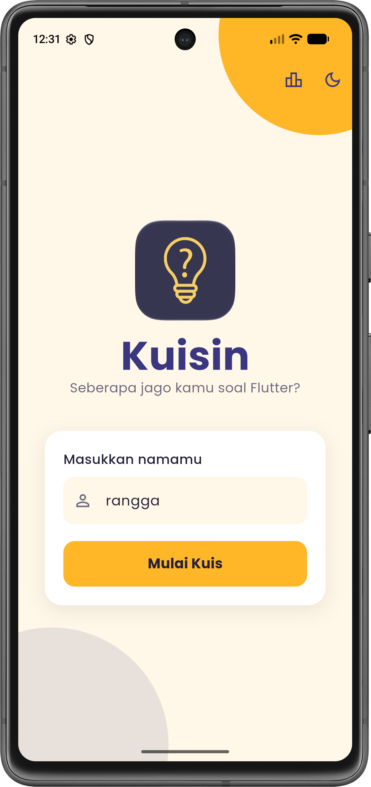
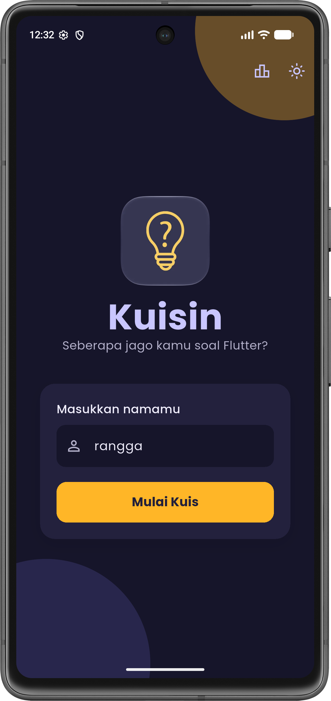
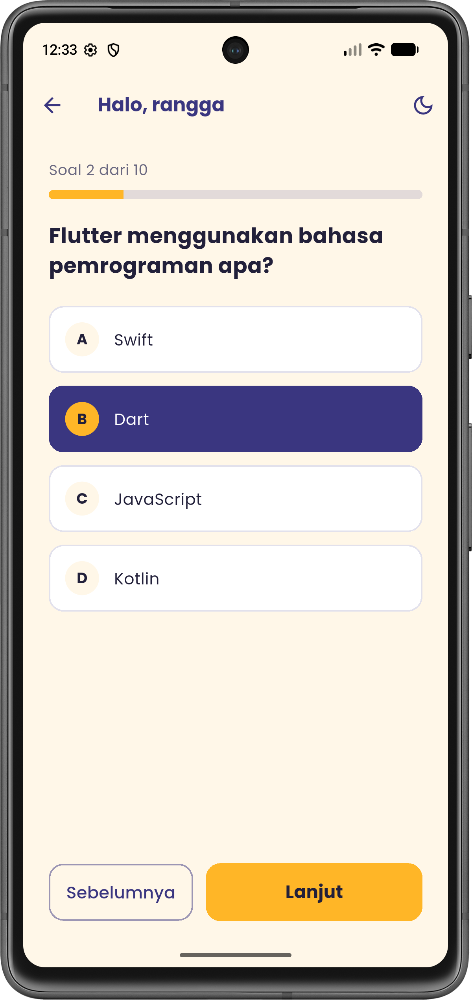
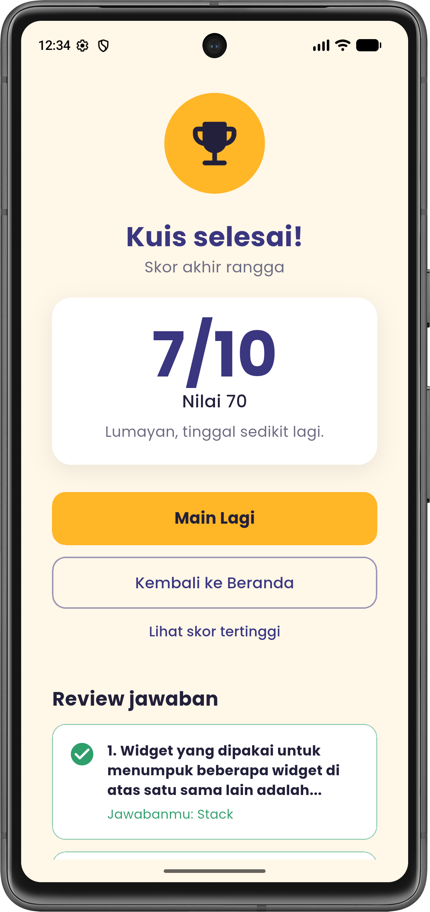
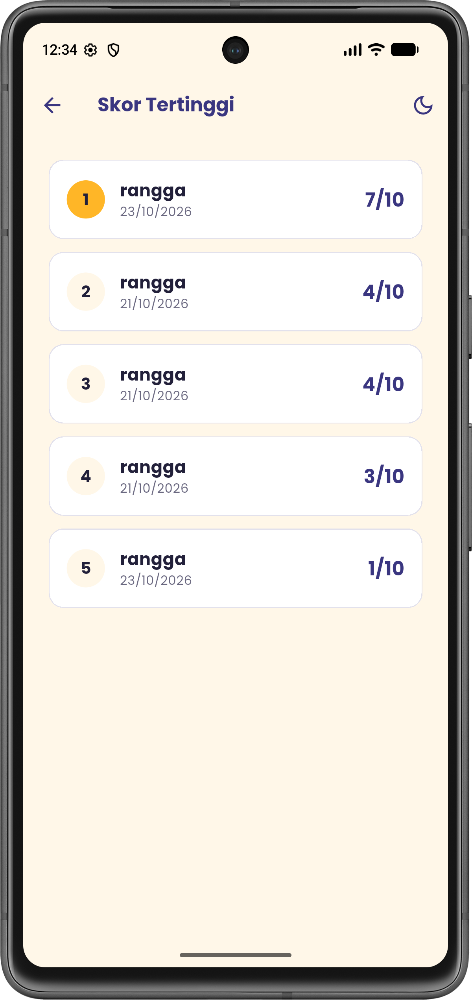
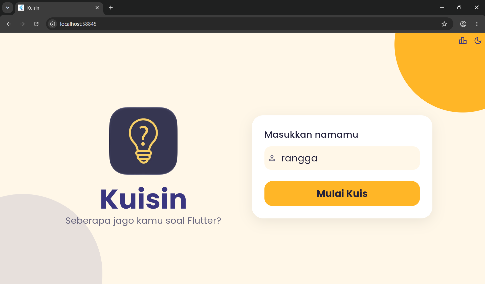

# Kuisin

UTS PEMROGRAMAN MOBILE

Nama: Rangga Adittya Prayoga  
NIM : 241401140  
Lab : 3

## Tentang aplikasi

Kuisin adalah aplikasi kuis pilihan ganda tentang dasar-dasar Flutter. Isi nama dulu, jawab 10 soal, lalu lihat skor akhirnya. Soal dan pilihan jawabannya diacak setiap main, jadi urutannya selalu beda.

## Fitur

- Input nama di halaman awal, tidak boleh kosong
- 10 soal, bisa lanjut dan balik ke soal sebelumnya
- Progres jawaban tetap aman waktu layar diputar atau pindah halaman
- Kalau keluar di tengah kuis ada konfirmasi, dan bisa dilanjutkan lagi pakai nama yang sama
- Halaman hasil menampilkan skor dan review jawaban yang benar dan salah
- Skor tertinggi disimpan di perangkat
- Dark mode
- Di tablet dan web tampilannya jadi dua kolom

## Screenshot

Home (terang dan gelap)

 

Kuis

Hasil dan skor tertinggi

 

Tampilan tablet / web

## Mockup

https://www.figma.com/design/QwUenNQehn9xcymwqXa0MI/Kuisin-mock-up?m=auto&t=SA5Rbh3at1rfyolg-1

## Video presentasi

https://drive.google.com/file/d/1I2Xh-Yjigx1MP1zcrW0JMevbGPA4I11C/view?usp=sharing

## Credit

- Font Poppins dari Google Fonts (lisensi OFL)
- Ikon dari Material Icons bawaan Flutter
- Untuk logo nya menggunakan logo aplikasi 'Guesstimate - culture quiz' via Apple Store (https://apps.apple.com/us/app/guesstimate-culture-quiz/id1614505455)

## Note

State management pakai Provider, skor tertinggi disimpan dengan shared_preferences, dan fontnya Poppins. Untuk menjalankan: `flutter pub get` lalu `flutter run`.
